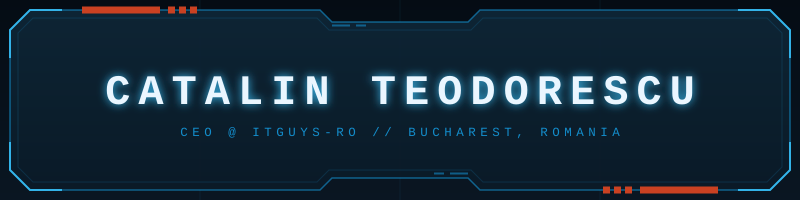

<picture>
  <source media="(prefers-color-scheme: dark)" srcset="https://raw.githubusercontent.com/dustfeather/dustfeather/main/name-dark.svg" />
  <source media="(prefers-color-scheme: light)" srcset="https://raw.githubusercontent.com/dustfeather/dustfeather/main/name-light.svg" />
  
</picture>

*[Full-stack engineer](https://www.linkedin.com/in/dustfeather/) turned [company builder](https://itguys.ro).*

*Most of my work lives in private repos, but here's the gist:*

<!-- BADGE-BOT:START -->
| Domain | Stack |
| --- | --- |
| **BROWSER EXTENSIONS** | <kbd>Chrome MV3</kbd> <kbd>Firefox</kbd> <kbd>TypeScript</kbd> <kbd>Userscripts</kbd> <kbd>Vite/esbuild</kbd> |
| **SERVERLESS SAAS** | <kbd>Serverless Workers</kbd> <kbd>Edge SQL</kbd> <kbd>Next.js</kbd> <kbd>Drizzle ORM</kbd> <kbd>Hono</kbd> |
| **SELF-HOSTED INFRA** | <kbd>k3s</kbd> <kbd>Helm</kbd> <kbd>Prometheus</kbd> <kbd>Grafana</kbd> <kbd>Zero-Trust</kbd> |
| **AI ENGINEERING** | <kbd>LLM Agents</kbd> <kbd>RAG</kbd> <kbd>MCP</kbd> <kbd>Local LLMs</kbd> <kbd>FastAPI</kbd> |
| **DEVOPS &amp; CI** | <kbd>GitHub Actions</kbd> <kbd>Reusable CI</kbd> <kbd>Docker</kbd> <kbd>Helm</kbd> <kbd>Deploy Config</kbd> |
| **DEVELOPER TOOLING** | <kbd>CLI</kbd> <kbd>Node.js</kbd> <kbd>Markdown</kbd> <kbd>Agent Hooks</kbd> <kbd>Rust</kbd> |
| **MOBILE &amp; PROTOCOLS** | <kbd>Kotlin</kbd> <kbd>Android</kbd> <kbd>Compose</kbd> <kbd>Protobuf</kbd> <kbd>Car Apps</kbd> |
| **AUTOMATION &amp; BOTS** | <kbd>Python</kbd> <kbd>Telegram Bot</kbd> <kbd>Cron Jobs</kbd> <kbd>Alerts</kbd> <kbd>Trading Bots</kbd> |

---

- **Browser extensions** - Manifest V3 extensions and userscripts in TypeScript for Chrome and Firefox, including chrome-group-discard, discord-purge, uninsta, filelist-ext and series-auto-skip.
- **Serverless web apps and SaaS** - Multi-tenant and personal web products in TypeScript on Next.js, Astro and Hono, deployed to Cloudflare Workers with D1, including the public gw2roi crafting-profit board and private SaaS, marketplace, finance and corporate-site projects.
- **Self-hosted Kubernetes platform** - A k3s homelab cluster managed with Helm and shell runbooks, observability via Prometheus, Grafana and Loki, and self-hosted services such as the public nextcloud GitOps deployment and a backed-up password manager.
- **AI workspaces and local inference** - Self-hosted AI tooling including the public odysseus FastAPI workspace with RAG and MCP, the social-update LLM journal, and GPU-offload benchmarking of llama.cpp and Ollama for local models.
- **CI/CD and deployment automation** - Reusable GitHub Actions workflows in shared-workflows covering Node, Python, extension publishing, Cloudflare and k3s deploys, plus deploy-only configs for static sites on edge Workers.
- **Developer and productivity tools** - Local-first tools such as the deckrun Markdown slide CLI, the advisory-db Rust security advisory database, and versioned Claude Code config with hooks, skills and secret scanning.
- **Android and automotive protocols** - AARE, an open-source Kotlin reimplementation of Android Auto's phone side that speaks the AAP protocol and runs Car App Library apps without Google Play Services.
- **Bots and scheduled automation** - Python and TypeScript automation such as the device-activity-telegram-bot for login alerts and remote shutdown, plus cron-driven pipelines and a trading bot.

---

`📡 Currently exploring Local LLM inference and self-hosted AI agents`
<!-- BADGE-BOT:END -->

[contact@itguys.ro](mailto:contact@itguys.ro)
